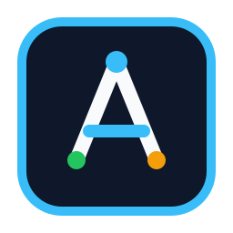

<p align="center">
  
</p>

<h1 align="center">AGY Harness</h1>

<p align="center">
  <b>English</b> | <a href="README.zh.md">简体中文</a>
</p>

<p align="center">
  <a href="https://github.com/JsonLee12138/agy-harness/releases/tag/v0.4.0"></a>
  <a href="LICENSE"></a>
  <a href="https://github.com/JsonLee12138/agy-harness"></a>
  <a href="https://github.com/JsonLee12138/agy-harness"></a>
  <a href="https://github.com/JsonLee12138/agy-harness"></a>
</p>

**Adaptive Generate-and-Falsify Engineering Harness for Google Antigravity (`agy`), Claude Code, Codex, and modern AI coding agents.**

Powered by 25 zero-modification upstream [Addy Osmani Agent Skills](https://github.com/addyosmani/agent-skills) plus clean-room `/agy-harness:harness-init`.

> [!IMPORTANT]
> **Independent Versioning Notice**: `agy-harness` maintains its own semantic versioning (currently **`v0.4.0`**), decoupled from upstream `agent-skills` `0.6.x`, to evolve the Antigravity harness architecture, gates, and subagents independently.

---

## What is AGY Harness?

Pure "vibe coding" creates unmaintainable spaghetti and late-stage rework, while overly rigid frameworks burn millions of tokens on enterprise ceremony and duplicate test loops. `agy-harness` v0.4 strikes the practical sweet spot — **minimal rework and high code safety with zero wasted ceremony**:

- **Clean-room bootstrap (`/agy-harness:harness-init`) + Global `hooks.json`**: Installs slim `.agents/rules/agy-harness.md` (`3,459 B` / `<= 3.5 KB` within AGY's `20,000`-token `defaultRulesBudget`), polyglot `scripts/gate-check.sh`, and lean `.artifacts/{SPEC,CONSTRAINTS,PLAN}.md`. Global plugin-root [`hooks.json`](hooks.json) (`--plugin-mode`) runs without copying 6,600 lines of guard scripts into target repos — and automatically cleans up legacy v0.1–v0.3 `scripts/harness-*.sh`, `scripts/hooks/`, and unfilled `context-brief.md` clutter! (`--standalone` isolates offline hooks cleanly inside `.agents/hooks/`.)
- **Adaptive 3-Mode Routing (`Trivial` / `Bug Fix` / `Contract`)**:
  - **Trivial**: Literal/constant/style/copy/locale/1:1 field pass-throughs edit directly in warm cache and skip `Stop` full-gate loops (`isTrivialExemptPath`).
  - **Bug Fix**: Non-literal bugs require read-only root-cause diagnosis -> **pre-confirmation `arch-redteam`** -> user confirmation of **[Root Cause + Proposal]** -> minimal fix + regression test (supports `HARNESS_STATUS: PAUSED` for mid-feature side-quests).
  - **Contract**: Business encapsulation, schema/API changes, design forks, or any high-risk security path (even 1 file) draft `.artifacts/{SPEC,PLAN}.md`, run **pre-confirmation `arch-redteam`**, and lock via 1-click `Proceed` (allowing warm-cache parent edits post-`Proceed` unless `HARNESS_EXECUTION: SUBAGENT_ONLY` is set).
- **Zero-Duplicate Gates (`[Gate Dedup]`) & Per-Conversation `Stop` Isolation**: `scripts/gate-check.sh` auto-detects `pnpm`/`bun`/`yarn`/`npm`, `cargo`, `go`, `ruff`/`pytest`, and `dart`/`flutter`, and caches a SHA-256 Git working-tree fingerprint on full passes (`--force` bypasses; `--fast` runs incremental checks). `Stop` inspects the current conversation's own mutations so read-only Q&A sessions are never hijacked by another dirty session.
- **Dual-Layer Anti-Hang Watchdog & Micro-Capsuled Subagents (`skills: []`)**: Strips ~12.5k–21.5k static preload tokens from `agents/*.md` in favor of embedded high-signal checklists; equips `slice-builder` with `manage_task` + `NotificationTimeoutSeconds: 45` `overwrite` for WS/DB handle cleanup; and pairs delegations with a 0-cost-on-reply `75s` coordinator `schedule(TimerCondition)` watchdog.

---

## Quick Start

### 1. Install `agy-harness`

```bash
agy plugin install https://github.com/JsonLee12138/agy-harness.git
agy plugin disable agent-skills   # avoid duplicate 25-skill catalog tokens
```

*(Also compatible with Claude Code `/plugin install agy-harness@agy-harness`, Codex `codex plugin add`, and `npx skills add JsonLee12138/agy-harness`.)*

### 2. Initialize Any Target Repository

Run `/agy-harness:harness-init` in chat or from terminal:

```bash
# Default clean-room mode (uses global plugin hooks & cleans legacy v0.3 clutter):
bash ~/.gemini/config/plugins/agy-harness/scripts/init-harness.sh /path/to/your-project

# Standalone offline mode (installs hooks/core/agents under .agents/hooks/ and .agents/agents/):
bash /path/to/agy-harness/scripts/init-harness.sh /path/to/your-project --standalone
```

---

## 3-Mode Adaptive Routing (`Trivial` / `Bug Fix` / `Contract`)

| Mode | Trigger Scope | Pipeline & Checkpoints |
|---|---|---|
| **Trivial** | Literal/constant/style (`.css`/`.scss`)/copy/locale JSON/static config or 1:1 field pass-through (no logic branches, abstraction changes, or security risk) | Direct warm-cache edit + fast check (`isTrivialExemptPath` exempts `Stop` full-gate loops; allowed mid-contract when `PAUSED`) |
| **Bug Fix** | Non-literal bugs (errors, state/async/race/crash defects, including mid-feature side-quests) | Read-only root-cause diagnosis -> **pre-confirmation `arch-redteam`** -> user confirms **[Root Cause + Proposal]** -> minimal fix + regression test + deduped `gate-check.sh` |
| **Contract** | Business encapsulation/shared hooks/SDK/middleware, multi-state workflows, DB/API schema, design forks, or **any high-risk security/auth/input/crypto/billing/concurrency path (even 1 file)** | Draft `.artifacts/{SPEC,PLAN}.md` -> **pre-confirmation `arch-redteam`** -> 1-click `Proceed` -> warm-cache parent or `SUBAGENT_ONLY` `slice-builder` (`75s` watchdog) -> deduped `gate-check.sh` -> 4-in-1 `staff-gatekeeper` -> `kill` |

---

## Harness Subagents

Three lean physically isolated subagents (`model: inherit`, `mcpServers: []`, `skills: []` micro-capsules):

| Subagent | Tools, Frontmatter `hooks:` & Watchdog | Role |
|---|---|---|
| [arch-redteam](agents/arch-redteam.md) | **Read-only** (`read_file` + legacy aliases; `policy: off`) | Pre-confirmation adversarial auditor for Bug Fix proposals & `.artifacts/{SPEC,PLAN}.md` |
| [slice-builder](agents/slice-builder.md) | Read + Write + `run_command` + `manage_task` (`sandbox`) + [`slice-builder.hooks.json`](scripts/hooks/slice-builder.hooks.json) | Isolated TDD builder for parallel/heavy slices; `NotificationTimeoutSeconds: 45` `overwrite` + `75s` coordinator watchdog |
| [staff-gatekeeper](agents/staff-gatekeeper.md) | **Read-only** + `run_command` (`sandbox`) + [`staff-gatekeeper.hooks.json`](scripts/hooks/staff-gatekeeper.hooks.json) | **4-in-1** unified reviewer: contract, Occam pruning, anti-fake-test mutation check, and security/perf audit |

> See **[docs/antigravity-setup.md](docs/antigravity-setup.md)** and **[docs/agents.md](docs/agents.md)** for complete hook, permission layering, and validation details.

---

## Validation

```bash
node scripts/validate-versions.js && \
node scripts/validate-skills.js && \
node scripts/validate-reference-links.js && \
node scripts/validate-artifact-paths.js && \
node scripts/validate-commands.js && \
CI=true node --test scripts/*test.js && \
node scripts/run-evals.js && \
agy plugin validate . && \
bash scripts/gate-check.sh --force && \
bash scripts/gate-check.sh
```

## License

MIT — see [LICENSE](LICENSE).
