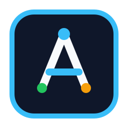

<p align="center">
  
</p>

<h1 align="center">AGY Harness</h1>

<p align="center">
  <b>English</b> | <a href="README.zh.md">简体中文</a>
</p>

<p align="center">
  <a href="https://github.com/JsonLee12138/agy-harness/releases/tag/v0.1.0"></a>
  <a href="LICENSE"></a>
  <a href="https://github.com/JsonLee12138/agy-harness"></a>
  <a href="https://github.com/JsonLee12138/agy-harness"></a>
  <a href="https://github.com/JsonLee12138/agy-harness"></a>
</p>

**Budget-governed Generate-and-Falsify Engineering Harness for Google Antigravity (`agy`), Claude Code, Codex, and modern AI coding agents.**

Powered by 25 zero-modification upstream [Addy Osmani Agent Skills](https://github.com/addyosmani/agent-skills) plus `/agy-harness:harness-init`.

> [!IMPORTANT]
> **Independent Versioning Notice**: `agy-harness` starts its release versioning at **`v0.1.0`**. It intentionally does not inherit upstream `agent-skills` 0.6.x versions, establishing its own release cadence for the Antigravity harness architecture, gates, and subagents.

---

## What is AGY Harness?

Default AI coding agents take the path of least resistance: single-turn execution, skipping specs, omitting tests, and having the same polluted context review its own hallucinations.

`agy-harness` transforms agent interactions into a deterministic **Disk SSoT (`.artifacts/`) + Software 1.0 Gate (`scripts/gate-check.sh`) + Physically Isolated Fresh-Context Subagent** state machine:

- **One-step workspace bootstrap (`/agy-harness:harness-init`)**: Registers `.agents/rules/agy-harness.md` (replacing the deprecated UI `mainAgent` switcher), `.agents/hooks.json` + `scripts/harness-approval-gate.sh` (Software 1.0 `PreToolUse` contract approval lock), `scripts/gate-check.sh`, and `.artifacts/{context-brief,SPEC,CONSTRAINTS,PLAN}.md`.
- **Native `Proceed` human confirmation gates**: Tier M pauses once (`SPEC + PLAN`), Tier L/XL pauses twice (`SPEC` first, then `arch-redteam`-converged `PLAN`), and every substantive edit to `SPEC.md` or `PLAN.md` physically requires re-confirmation before `slice-builder` or `swarm` can run.
- **Self-contained `agy-harness:*` namespace**: Ships all 25 upstream skills untouched (ready for seamless upstream `git merge`) plus `harness-init`. Disable standalone `agent-skills` after installing to avoid duplicate skill-catalog token overhead.
- **Software 1.0 zero-token gates (`scripts/gate-check.sh`)**: Enforces diff size limits (< 400 lines), typecheck/lint, deterministic tests, and secret / `debugger;` scans before waking costly `pro` review subagents.
- **5 physically isolated subagents**: Read-only hardware separation for fact probes and review, routing tasks across heterogeneous model tiers (`flash` / `inherit` / `pro`).
- **Tier S / M / L / XL budget routing**: Scales from zero-subagent Tier S fixes up to Tier XL parallel worktree sharding (`Workspace: "share"` / Native `Swarm`).

```
  DEFINE          PLAN           BUILD          VERIFY         REVIEW          SHIP
 ┌──────┐      ┌──────┐      ┌──────┐      ┌──────┐      ┌──────┐      ┌──────┐
 │ Idea │ ───▶ │ Spec │ ───▶ │ Code │ ───▶ │ Test │ ───▶ │  QA  │ ───▶ │  Go  │
 │Refine│      │  PRD │      │ Impl │      │Debug │      │ Gate │      │ Live │
 └──────┘      └──────┘      └──────┘      └──────┘      └──────┘      └──────┘
  /spec          /plan          /build        /test         /review       /ship
```

For complete architectural details and golden evaluation instructions, see **[docs/antigravity-setup.md](docs/antigravity-setup.md)**.

---

## Quick Start

### 1. Install `agy-harness`

<details open>
<summary><b>Google Antigravity (CLI, IDE & 2.0) — Primary Host</b></summary>

Install directly from the remote repository:

```bash
agy plugin install https://github.com/JsonLee12138/agy-harness.git
```

Or install from a local clone:

```bash
git clone https://github.com/JsonLee12138/agy-harness.git
agy plugin install ./agy-harness
```

> [!TIP]
> **Disable Standalone `agent-skills`**: Because `agy-harness` bundles all 25 upstream skills under the `agy-harness:*` namespace, disable standalone `agent-skills` if previously installed to avoid duplicate token overhead:
> ```bash
> agy plugin disable agent-skills
> ```

</details>

<details>
<summary><b>Claude Code</b></summary>

**Marketplace install:**

```bash
/plugin marketplace add JsonLee12138/agy-harness
/plugin install agy-harness@agy-harness
```

**Local / development:**

```bash
git clone https://github.com/JsonLee12138/agy-harness.git
claude --plugin-dir /path/to/agy-harness
```

</details>

<details>
<summary><b>Codex</b></summary>

Install as a native Codex plugin (Codex CLI v0.122+):

```bash
codex plugin marketplace add JsonLee12138/agy-harness
codex plugin add agy-harness@agy-harness
```

Codex reads the `skills/` directory directly through `.codex-plugin/plugin.json`. Invoke skills in chat using `@` (e.g. `@spec-driven-development`).

</details>

<details>
<summary><b>Skills CLI (Universal Installer for 70+ Agents)</b></summary>

Using the open [skills CLI](https://github.com/vercel-labs/skills):

```bash
npx skills add JsonLee12138/agy-harness            # install all skills
npx skills add JsonLee12138/agy-harness --list     # browse before installing
```

</details>

<details>
<summary><b>Cursor, Windsurf & Other Environments</b></summary>

- **Cursor**: Place workflow skills under `.cursor/skills/` (sync from `skills/`). See [docs/cursor-setup.md](docs/cursor-setup.md).
- **Windsurf**: Add skills to your rules configuration. See [docs/windsurf-setup.md](docs/windsurf-setup.md).
- **Gemini CLI**: Run `gemini skills install https://github.com/JsonLee12138/agy-harness.git --path skills`. See [docs/gemini-cli-setup.md](docs/gemini-cli-setup.md).
- **OpenCode**: Copy skills to `.opencode/skills/`. See [docs/opencode-setup.md](docs/opencode-setup.md).
- **GitHub Copilot**: Use subagent definitions in `.github/agents/`. See [docs/copilot-setup.md](docs/copilot-setup.md).

</details>

---

### 2. Initialize Any Target Repository

In your target project, trigger the initialization skill in chat:

```text
/agy-harness:harness-init
```

Or run the initialization script directly from terminal:

```bash
# Using installed plugin:
bash ~/.gemini/config/plugins/agy-harness/scripts/init-harness.sh /path/to/your-project

# Or with local subagents:
bash /path/to/agy-harness/scripts/init-harness.sh /path/to/your-project --with-local-agents
```

This sets up:
1. `.agents/rules/agy-harness.md` — Workspace coordinator rule with Tier S/M/L/XL routing and human approval gates.
2. `.agents/hooks.json` + `scripts/harness-approval-gate.sh` — Software 1.0 approval lock before code execution.
3. `scripts/gate-check.sh` — Zero-token pre-commit quality gate.
4. `.artifacts/{context-brief,SPEC,CONSTRAINTS,PLAN}.md` — Local gitignored contract templates.

---

## Tier S / M / L / XL Budget Routing

`agy-harness` routes every task to the optimal balance between token expenditure and verification rigor:

| Tier | Scope | Pipeline & Human Checkpoints | Cost Multiplier |
|------|-------|------------------------------|-----------------|
| **Tier S** | Single-file bugfix, copy/style tweak, < 50 lines | Main session TDD -> `gate-check.sh` -> Done (0 subagents) | **1.0x** |
| **Tier M** | Standard feature or refactor (2-6 files) | `repo-scout` -> `.artifacts/` contracts -> **`Proceed` #1** -> `slice-builder` -> `gate-check.sh` -> `staff-gatekeeper` | **1.8x** |
| **Tier L** | Architecture change, public API, auth/payment | `repo-scout` -> `SPEC` -> **`Proceed` #1** -> `PLAN` + `arch-redteam` -> **`Proceed` #2** -> `slice-builder` -> `gate-check.sh` -> `staff-gatekeeper` + `risk-specialist` | **2.6x** |
| **Tier XL** | >= 3 orthogonal modules with disjoint trees | `repo-scout` -> `SPEC` -> **`Proceed` #1** -> Subtree `PLAN` + `arch-redteam` -> **`Proceed` #2** -> Parallel `slice-builder` (`Workspace: "share"`) -> `gate-check.sh` -> `staff-gatekeeper` | **2.2x - 3.2x** |

---

## Harness Subagents

Five physically isolated subagents orchestrated by `.agents/rules/agy-harness.md`:

| Subagent | Model Tier | Tools & Isolation | Role |
|----------|------------|-------------------|------|
| [repo-scout](agents/repo-scout.md) | `flash` | Read-only (`off`) | Fast codebase and official-doc fact probe producing concise (`<= 2K` tokens) Context Briefs |
| [arch-redteam](agents/arch-redteam.md) | `pro` | Read-only (`off`) | Blank-context adversarial auditor for `SPEC.md` and `PLAN.md` with anti-overengineering guardrails |
| [slice-builder](agents/slice-builder.md) | `inherit` | Read + Write (`sandbox`) | Vertical-slice TDD builder; verifies `scripts/gate-check.sh` before handoff; supports worktree sharding |
| [staff-gatekeeper](agents/staff-gatekeeper.md) | `pro` | Read-only (`sandbox`) | 3-in-1 unified post-gate reviewer: five-axis quality, complexity pruning, and anti-fake-test check |
| [risk-specialist](agents/risk-specialist.md) | `pro` | Read-only (`sandbox`) | Conditional deep auditor for auth, external input, high-traffic paths, and performance hotspots |

> Legacy single-axis personas are safely preserved in [docs/legacy-personas/](docs/legacy-personas/).

---

## All 26 Skills

The pack bundles 26 skills total: 25 upstream engineering skills plus `harness-init`.

### Meta & Harness Bootstrap

| Skill | What It Does | Use When |
|-------|-------------|----------|
| [harness-init](skills/harness-init/SKILL.md) | Bootstraps `.agents/rules/agy-harness.md`, `.agents/hooks.json`, `scripts/gate-check.sh`, and `.artifacts/` templates | Initializing `agy-harness` in a repository (`/agy-harness:harness-init`) |
| [using-agent-skills](skills/using-agent-skills/SKILL.md) | Maps incoming work to the right skill workflow and defines shared operating rules | Starting a session or deciding which skill applies |

### Define — Clarify What to Build

| Skill | What It Does | Use When |
|-------|-------------|----------|
| [interview-me](skills/interview-me/SKILL.md) | One-question-at-a-time interview extracting core requirements until ~95% confidence | The ask is underspecified, or "interview me" / "grill me" is invoked |
| [idea-refine](skills/idea-refine/SKILL.md) | Structured divergent/convergent thinking turning vague concepts into concrete proposals | Exploring a rough concept before committing to planning |
| [spec-driven-development](skills/spec-driven-development/SKILL.md) | Drafts a PRD covering objectives, commands, architecture, and testing before code | Starting a new project, feature, or major refactoring |
| [constraint-driven-development](skills/constraint-driven-development/SKILL.md) | Defines and locks quality constraints in `CONSTRAINTS.md`, preventing silent bar-lowering | Setting up quality thresholds or preventing agents from silencing tests |

### Plan — Break Work Down

| Skill | What It Does | Use When |
|-------|-------------|----------|
| [planning-and-task-breakdown](skills/planning-and-task-breakdown/SKILL.md) | Decomposes specs into atomic, testable vertical tasks with dependency ordering | Breaking down an approved spec into actionable engineering slices |

### Build — Implement with Discipline

| Skill | What It Does | Use When |
|-------|-------------|----------|
| [incremental-implementation](skills/incremental-implementation/SKILL.md) | Thin vertical slices — implement, test, verify, commit with feature flags & safe defaults | Any change touching more than one file |
| [test-driven-development](skills/test-driven-development/SKILL.md) | Red-Green-Refactor loop, test pyramid, Beyonce Rule, deterministic unit & integration tests | Implementing new logic, fixing bugs, or modifying behavior |
| [context-engineering](skills/context-engineering/SKILL.md) | Context hygiene, payload minimization, rules files, and MCP integration tuning | Starting sessions or optimizing token usage |
| [source-driven-development](skills/source-driven-development/SKILL.md) | Grounds every technical decision in official documentation and cited sources | Building with external frameworks or libraries where accuracy matters |
| [doubt-driven-development](skills/doubt-driven-development/SKILL.md) | Adversarial fresh-context review of in-flight decisions (CLAIM -> EXTRACT -> DOUBT -> RECONCILE) | High-stakes tasks (auth, schema migration, irreversible operations) |
| [frontend-ui-engineering](skills/frontend-ui-engineering/SKILL.md) | Component architecture, responsive design, state management, WCAG 2.1 AA accessibility | Building or updating user-facing user interfaces |
| [api-and-interface-design](skills/api-and-interface-design/SKILL.md) | Contract-first API design, Hyrum's Law, error semantics, and backward compatibility | Designing APIs, SDKs, module boundaries, or public contracts |

### Verify — Prove It Works

| Skill | What It Does | Use When |
|-------|-------------|----------|
| [browser-testing-with-devtools](skills/browser-testing-with-devtools/SKILL.md) | Chrome DevTools MCP for live runtime inspection — DOM, console, network traces, CWV profiling | Building or debugging web applications running in a browser |
| [debugging-and-error-recovery](skills/debugging-and-error-recovery/SKILL.md) | 5-step systematic root-cause debugging: reproduce, localize, reduce, fix, guard | Tests fail, builds break, or unexpected runtime errors occur |

### Review — Multi-Axis Quality Gates

| Skill | What It Does | Use When |
|-------|-------------|----------|
| [code-review-and-quality](skills/code-review-and-quality/SKILL.md) | Five-axis code review, change sizing (~100 lines), severity labels, staff engineer bar | Prior to merging any code change |
| [code-simplification](skills/code-simplification/SKILL.md) | Chesterton's Fence, dead-code removal, reducing cognitive complexity preserving behavior | Code works but is overly complex or difficult to maintain |
| [security-and-hardening](skills/security-and-hardening/SKILL.md) | OWASP Top 10 mitigation, auth patterns, secret handling, dependency vulnerability auditing | Handling untrusted input, user sessions, or external APIs |
| [performance-optimization](skills/performance-optimization/SKILL.md) | Measure-first optimization, Core Web Vitals targets, bundle analysis, N+1 query elimination | Addressing latency, throughput, or memory bottlenecks |

### Ship — Production Release

| Skill | What It Does | Use When |
|-------|-------------|----------|
| [git-workflow-and-versioning](skills/git-workflow-and-versioning/SKILL.md) | Trunk-based development, atomic commits, semantic versioning, and human-facing changelogs | Every code change, branch, commit, tag, and release |
| [ci-cd-and-automation](skills/ci-cd-and-automation/SKILL.md) | Shift-Left testing, pipeline quality gates, failure feedback loops, feature flags | Setting up or updating CI/CD build and release workflows |
| [deprecation-and-migration](skills/deprecation-and-migration/SKILL.md) | Code-as-liability mindset, expand/contract migrations, zero-downtime schema evolution | Sunsetting legacy APIs, removing deprecated code, database migrations |
| [documentation-and-adrs](skills/documentation-and-adrs/SKILL.md) | Architecture Decision Records (ADRs), API docs, documenting the *why* behind decisions | Changing architectural foundations, APIs, or major features |
| [observability-and-instrumentation](skills/observability-and-instrumentation/SKILL.md) | Structured logging, RED/USE metrics, OpenTelemetry distributed tracing, symptom alerting | Adding telemetry or preparing production services |
| [shipping-and-launch](skills/shipping-and-launch/SKILL.md) | Pre-launch checklists, staged rollouts, rollback plans, production smoke verification | Preparing to release features or versions to production |

---

## Reference Checklists

Included checklists referenced dynamically by the skills:

- [definition-of-done.md](references/definition-of-done.md) — Universal completion criteria for all changes.
- [testing-patterns.md](references/testing-patterns.md) — Test sizing, naming conventions, mock patterns, and anti-patterns.
- [security-checklist.md](references/security-checklist.md) — Pre-commit security checks, auth, input validation, and OWASP Top 10.
- [performance-checklist.md](references/performance-checklist.md) — Core Web Vitals targets, database query checklist, and profiling tools.
- [accessibility-checklist.md](references/accessibility-checklist.md) — Keyboard navigation, screen readers, ARIA, and WCAG 2.1 standards.
- [observability-checklist.md](references/observability-checklist.md) — Structured logging, RED metrics, alerting rules, and incident diagnosis.
- [orchestration-patterns.md](references/orchestration-patterns.md) — Multi-agent patterns, parallel fan-out, and delegation rules.

---

## Acknowledgements & Credits

`agy-harness` is built upon the foundational work of **Addy Osmani** and the contributors of [`addyosmani/agent-skills`](https://github.com/addyosmani/agent-skills):

- **Addy Osmani** ([@addyosmani](https://github.com/addyosmani)) — Creator of Agent Skills
- **Federico Bartoli** ([@federicobartoli](https://github.com/federicobartoli)) — Collaborator
- **Joan León** ([@nucliweb](https://github.com/nucliweb)) — Collaborator

`agy-harness` is adapted and maintained by **JsonLee12138** ([@JsonLee12138](https://github.com/JsonLee12138)), adding Google Antigravity harness orchestration, Software 1.0 gates, Disk SSoT contracts, and isolated subagent architectures.

---

## License

MIT License. See [LICENSE](LICENSE) for details.
