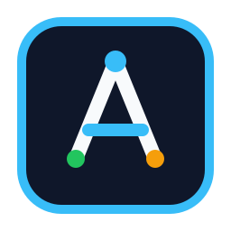

<p align="center">
  
</p>

<h1 align="center">AGY Harness</h1>

<p align="center">
  <a href="README.md">English</a> | <b>简体中文</b>
</p>

<p align="center">
  <a href="https://github.com/JsonLee12138/agy-harness/releases/tag/v0.1.0"></a>
  <a href="LICENSE"></a>
  <a href="https://github.com/JsonLee12138/agy-harness"></a>
  <a href="https://github.com/JsonLee12138/agy-harness"></a>
  <a href="https://github.com/JsonLee12138/agy-harness"></a>
</p>

**面向 Google Antigravity (`agy`)、Claude Code、Codex 及现代多智能体编程环境的预算受控与“生成-证伪”工程脚手架。**

底层搭载 25 个原汁原味、零侵入的上游 [Addy Osmani Agent Skills](https://github.com/addyosmani/agent-skills)，结合一键脚手架注入技能 `/agy-harness:harness-init`。

> [!IMPORTANT]
> **独立版本发布说明**：`agy-harness` 从 **`v0.1.0`** 正式起步。为了避免与上游 `agent-skills` 的 `0.6.x` 版本混淆，本项目采用完全独立的语义化版本体系，专注演进 Antigravity 脚手架调度、磁盘契约与代码门禁。

---

## 为什么需要 AGY Harness？

在没有严格约束的情况下，AI 编码智能体往往倾向于“走阻力最小的捷径”：单轮提示直接暴走写代码、跳过需求规格与边界分析、缺少测试、并在已经被污染的单一会话上下文中“自己审查自己的幻觉代码”，导致严重的质量滑坡与 Token 浪费。

`agy-harness` 将随意散漫的生成式会话，彻底重构为严密的 **磁盘单一事实来源（Disk SSoT: `.artifacts/`） + Software 1.0 确定性门禁（`scripts/gate-check.sh`） + 物理隔离的空白上下文子代理（Subagents）** 确定性状态机：

- **一键项目脚手架注入 (`/agy-harness:harness-init`)**：一键注入工作区协调者规则 `.agents/rules/agy-harness.md`、确定性审批锁 `.agents/hooks.json` + `scripts/harness-approval-gate.sh`、零 Token 门禁脚本 `scripts/gate-check.sh` 以及本地契约模板 `.artifacts/{context-brief,SPEC,CONSTRAINTS,PLAN}.md`。
- **先对齐后校验的原生 `Proceed` 门禁**：Tier M/L/XL 默认先就需求与核心方案对齐确认 **1 次 `Proceed`**，确认后再按风险触发 `arch-redteam` 校验（仅发现必须改范围/契约的 `[BLOCKER]` 时才二次比对确认）；进度勾选与 `## Implementation Notes / Guardrails` 非契约备注免重锁。
- **独立命名空间 `agy-harness:*` 与上游无缝同步**：完整保留上游 25 个生命周期技能，不改动任何一行上游逻辑，随时可接收上游 `git merge` 更新。安装后仅需禁用独立的 `agent-skills` 插件，即可规避重复注册导致的上下文 Token 浪费。
- **Software 1.0 零 Token 确定性门禁 (`scripts/gate-check.sh`)**：在唤醒昂贵的深度审查模型前，先通过本地脚本执行代码行数审查（< 400 行）、类型与代码格式检查、确定性单元测试以及密钥和 `debugger;` 扫描，绝不在坏代码上白花审查 Token。
- **5 大物理隔离的专业子代理**：通过工具白名单在底层物理剥离写权限，分别运行在分级模型层（`flash` / `inherit` / `pro`），消除同上下文自我审查与过度工程。
- **Tier S / M / L / XL 预算自适应路由**：从单文件零子代理极速修复（Tier S），平滑扩展至多工作区并行切片开发（Tier XL）。

```
  定义 (DEFINE)     规划 (PLAN)     构建 (BUILD)    验证 (VERIFY)   评审 (REVIEW)    发布 (SHIP)
 ┌──────────────┐  ┌─────────────┐  ┌─────────────┐  ┌─────────────┐  ┌─────────────┐  ┌────────────┐
 │  需求深挖    │─▶│  规格契约   │─▶│  TDD 施工   │─▶│  门禁自检   │─▶│  三合一评审 │─▶│  生产发布  │
 │ interview-me │  │  SPEC/PLAN  │  │slice-builder│  │ gate-check  │  │gatekeeper/QA│  │   上线     │
 └──────────────┘  └─────────────┘  └─────────────┘  └─────────────┘  └─────────────┘  └────────────┘
     /spec             /plan            /build           /test           /review          /ship
```

关于完整的 Antigravity 安装指南、配置与黄金评测集，请参阅 **[docs/antigravity-setup.md](docs/antigravity-setup.md)**。

---

## 快速上手

### 1. 安装 `agy-harness` 插件

<details open>
<summary><b>Google Antigravity (CLI, IDE & 2.0) —— 官方推荐宿主</b></summary>

直接从 GitHub 远程仓库安装：

```bash
agy plugin install https://github.com/JsonLee12138/agy-harness.git
```

或从本地克隆目录安装：

```bash
git clone https://github.com/JsonLee12138/agy-harness.git
agy plugin install ./agy-harness
```

> [!TIP]
> **排重优化建议**：由于 `agy-harness` 已经完整内置了上游 25 个技能，如果您之前安装过原版 `agent-skills`，建议将其禁用，以避免会话首轮由于技能清单重复累加带来约 2.5K Token 的不必要前缀开销：
> ```bash
> agy plugin disable agent-skills
> ```

</details>

<details>
<summary><b>Claude Code</b></summary>

**通过市场源安装：**

```bash
/plugin marketplace add JsonLee12138/agy-harness
/plugin install agy-harness@agy-harness
```

**本地开发加载：**

```bash
git clone https://github.com/JsonLee12138/agy-harness.git
claude --plugin-dir /path/to/agy-harness
```

</details>

<details>
<summary><b>Codex</b></summary>

作为 Codex 原生插件安装（Codex CLI v0.122+）：

```bash
codex plugin marketplace add JsonLee12138/agy-harness
codex plugin add agy-harness@agy-harness
```

Codex 通过 `.codex-plugin/plugin.json` 自动解析根目录的 `skills/`。在对话中使用 `@` 即可唤起（例如 `@spec-driven-development`）。

</details>

<details>
<summary><b>Skills CLI（支持 70+ 种 AI 编程工具）</b></summary>

使用开源 [skills CLI](https://github.com/vercel-labs/skills)：

```bash
npx skills add JsonLee12138/agy-harness            # 安装全部技能
npx skills add JsonLee12138/agy-harness --list     # 安装前查看列表
```

</details>

<details>
<summary><b>Cursor、Windsurf 及其他环境</b></summary>

- **Cursor**：将技能文件放入 `.cursor/skills/`（从 `skills/` 同步）。详见 [docs/cursor-setup.md](docs/cursor-setup.md)。
- **Windsurf**：将核心规范加入规则配置。详见 [docs/windsurf-setup.md](docs/windsurf-setup.md)。
- **Gemini CLI**：执行 `gemini skills install https://github.com/JsonLee12138/agy-harness.git --path skills`。详见 [docs/gemini-cli-setup.md](docs/gemini-cli-setup.md)。
- **OpenCode**：复制技能目录至 `.opencode/skills/`。详见 [docs/opencode-setup.md](docs/opencode-setup.md)。
- **GitHub Copilot**：将子代理规范添加至 `.github/agents/`。详见 [docs/copilot-setup.md](docs/copilot-setup.md)。

</details>

---

### 2. 在目标代码仓库中初始化脚手架

在你要开发的任何代码仓库中，只需在 Antigravity 聊天窗口中执行：

```text
/agy-harness:harness-init
```

或者直接在终端中运行初始化脚本：

```bash
# 全局已安装 agy-harness 插件时：
bash ~/.gemini/config/plugins/agy-harness/scripts/init-harness.sh /path/to/your-project

# 或使用包含独立本地子代理的模式：
bash /path/to/agy-harness/scripts/init-harness.sh /path/to/your-project --with-local-agents
```

该命令将在目标工程自动生成以下关键基础设施：
1. `.agents/rules/agy-harness.md` — 工作区协调状态机规则，负责 Tier S/M/L/XL 路由与 `Proceed` 检查点机制；
2. `.agents/hooks.json` + `scripts/harness-approval-gate.sh` — Software 1.0 物理审批锁，未获人类批准前硬阻断编码施工；
3. `scripts/gate-check.sh` — Software 1.0 零 Token 确定性质量门禁；
4. `.artifacts/{context-brief,SPEC,CONSTRAINTS,PLAN}.md` — 磁盘单一事实契约模板（自动加入 `.gitignore`，不污染代码历史与门禁统计）。

---

## 任务预算等级体系 (Tier S / M / L / XL)

为了兼顾开发效率与推理成本，`agy-harness` 预设了四级严格的预算与路由矩阵：

| 任务等级 (Tier) | 适用范围与特征 | 执行流水线与人类检查点 | 预估 Token 消耗倍数 |
|----------------|---------------|----------------------|--------------------|
| **Tier S** | `<= 3` 文件（含测试）、约 `<= 150` 行、无高敏/接口破坏 | 主会话直接执行 TDD 修复 -> 运行 `scripts/gate-check.sh` -> 交付（0 契约文档，0 子代理） | **1.0x**（基准） |
| **Tier M** | 常规跨文件特性开发或业务逻辑重构 | 主会话直读（按需 `repo-scout`）-> **人类点击 `Proceed` #1（确认需求与方案一致）** -> 弹性 `slice-builder`（内聚打包、`send_message` 原地续作）-> 运行 `gate-check.sh` -> 比对交付（大改动按需唤醒 `staff-gatekeeper`） | **1.3x - 1.6x** |
| **Tier L** | 核心架构重构、公共 API 变更、涉及鉴权/支付等高危路径 | 直读 / 按需 `repo-scout` -> **人类点击 `Proceed` #1（确认需求与方案一致）** -> `arch-redteam` 校验（仅 `[BLOCKER]` 才二次打回比对）-> 弹性 `slice-builder` -> 运行 `gate-check.sh` -> 并行唤醒 `staff-gatekeeper` 与 `risk-specialist` | **2.0x - 2.4x** |
| **Tier XL** | 包含 >= 3 个独立且互不干涉模块的大型史诗任务 | 直读 / 按需 `repo-scout` -> **人类 `Proceed` #1（确认需求与模块边界）** -> `arch-redteam` 校验（仅 `[BLOCKER]` 二次确认）-> 并行 `slice-builder`（`Workspace: "share"`）-> 运行 `gate-check.sh` -> `staff-gatekeeper` 验收 | **2.0x - 2.8x** |

---

## 五大物理隔离子代理 (Harness Subagents)

由工作区协调规则 `.agents/rules/agy-harness.md` 调度的专业子代理：

| 子代理 | 模型分级 (Tier) | 工具权限与隔离机制 | 职责与产出物 |
|--------|----------------|-------------------|--------------|
| [repo-scout](agents/repo-scout.md) | `flash` | 只读工具集（无文件写权限，`policy: off`） | 代码库探针与官方文档取证员，按需输出 `<= 2K` Token 的高信噪比事实上下文简报（Context Brief） |
| [arch-redteam](agents/arch-redteam.md) | `pro` | 只读工具集（无文件写权限，`policy: off`） | 架构与方案红队审校官。在方案对齐后按需执行对抗校验，拦截过度设计与隐含假设 |
| [slice-builder](agents/slice-builder.md) | `flash` | 完整读写沙箱（`policy: sandbox`） | 弹性 TDD 施工员。支持内聚打包、`send_message` 原地续作与 `gate-check.sh --fast` 快检 |
| [staff-gatekeeper](agents/staff-gatekeeper.md) | `pro` | 只读工具集（`policy: sandbox`） | 三合一统一门禁审校官：一次性完成五轴代码质量、复杂度奥卡姆修剪以及防作弊测试变异检查，节约 ~60% 前缀开销 |
| [risk-specialist](agents/risk-specialist.md) | `pro` | 只读工具集（`policy: sandbox`） | 安全与性能专项审计官。仅在变更触及敏感凭证、外部输入、高并发查询或渲染热路径时按需唤醒 |

> 注：原版单维度 Persona（如 `code-reviewer`, `security-auditor` 等）已归档至 [docs/legacy-personas/](docs/legacy-personas/)，使 Antigravity 的代理选择器聚焦于上述 5 大标准化角色。

---

## 26 个专业工程技能全览 (Skills)

包含完整的 25 个上游生命周期技能，加上 1 个脚手架注入技能 `harness-init`：

### 元认知与脚手架注入 (Meta & Bootstrap)

| 技能名称 | 功能概述 | 适用场景 |
|---------|---------|----------|
| [harness-init](skills/harness-init/SKILL.md) | 注入 `.agents/rules/agy-harness.md`、审批门禁、`gate-check.sh` 和 `.artifacts/` 契约模板 | 初始化目标工程（`/agy-harness:harness-init`） |
| [using-agent-skills](skills/using-agent-skills/SKILL.md) | 意图识别与技能映射，维护通用的工程准则 | 会话启动或判断当前任务适用何种流程 |

### 定义阶段 (Define) — 明确要做什么

| 技能名称 | 功能概述 | 适用场景 |
|---------|---------|----------|
| [interview-me](skills/interview-me/SKILL.md) | 单次单问的苏格拉底式提问，挖掘真实诉求直至 ~95% 置信度 | 需求模糊、缺少细节，或用户明确要求“盘问我/拷问我” |
| [idea-refine](skills/idea-refine/SKILL.md) | 发散/收敛结构化思考，将粗糙想法提炼为切实可行的方案 | 处于概念初期需要发散探索与收敛论证 |
| [spec-driven-development](skills/spec-driven-development/SKILL.md) | 在写代码前撰写包含目标、接口、测试策略的 PRD 规范 | 新项目开工、重大特性开发或跨模块调整 |
| [constraint-driven-development](skills/constraint-driven-development/SKILL.md) | 将质量门槛写入 `CONSTRAINTS.md`，杜绝 Agent 擅自压低标准 | 建立质量基线，防止 Agent 逃避测试或滥用跳过注释 |

### 规划阶段 (Plan) — 任务拆解与契约

| 技能名称 | 功能概述 | 适用场景 |
|---------|---------|----------|
| [planning-and-task-breakdown](skills/planning-and-task-breakdown/SKILL.md) | 将 PRD 规格拆解为带验收标准的原子切片任务并理顺依赖顺序 | 规格已确立，需要拆解为细粒度可执行工单 |

### 构建阶段 (Build) — 规范实施

| 技能名称 | 功能概述 | 适用场景 |
|---------|---------|----------|
| [incremental-implementation](skills/incremental-implementation/SKILL.md) | 极细垂直切片交付：实现、测试、验证、提交，保持变更易回滚 | 涉及跨多个文件的任何修改 |
| [test-driven-development](skills/test-driven-development/SKILL.md) | 红绿重构循环、测试金字塔、Beyonce 准则、确定性单元测试 | 编写业务逻辑、修复 Bug 或调整既有行为 |
| [context-engineering](skills/context-engineering/SKILL.md) | 上下文卫生学管理，修剪 Prompt 冗余与提升有效载荷信噪比 | 会话开启、任务切换或输出质量劣化时 |
| [source-driven-development](skills/source-driven-development/SKILL.md) | 坚持以权威官方文档为基准并注明引用来源，消除模型过时幻觉 | 依赖外部三方库或新版框架进行架构设计时 |
| [doubt-driven-development](skills/doubt-driven-development/SKILL.md) | 空白上下文对抗审校关键决策（声明->提取->质疑->调和） | 高风险操作（鉴权改动、数据迁移、不可逆变更） |
| [frontend-ui-engineering](skills/frontend-ui-engineering/SKILL.md) | 组件解耦设计、响应式布局、状态机流转、WCAG 2.1 AA 无障碍支持 | 前端交互、页面构建与设计系统实现 |
| [api-and-interface-design](skills/api-and-interface-design/SKILL.md) | 契约优先接口设计、Hyrum 定律防御、严格边界校验与版本兼容 | 设计 RESTful/GraphQL 接口、公共 SDK 或跨模块边界 |

### 验证阶段 (Verify) — 拿证据证明可用

| 技能名称 | 功能概述 | 适用场景 |
|---------|---------|----------|
| [browser-testing-with-devtools](skills/browser-testing-with-devtools/SKILL.md) | 结合 Chrome DevTools MCP 进行实时运行时排查（DOM、网络、控制台、CWV） | 构建或调试需要在浏览器中运行的 Web 应用 |
| [debugging-and-error-recovery](skills/debugging-and-error-recovery/SKILL.md) | 五步系统排错：复现、定位、精简、修复、守卫，严格拒绝猜测修复 | 测试红灯、构建报错或运行时行为偏离预期 |

### 评审阶段 (Review) — 合并前的多维质量把关

| 技能名称 | 功能概述 | 适用场景 |
|---------|---------|----------|
| [code-review-and-quality](skills/code-review-and-quality/SKILL.md) | 五轴代码审查、控制单次评审规模（~100 行）、分级严重度标签 | 合并任何 PR 或代码变更前 |
| [code-simplification](skills/code-simplification/SKILL.md) | 切斯特顿围栏原则、死代码清理、在保持完全等价行为下消减代码认知复杂度 | 代码能跑但晦涩冗长、难以维护时 |
| [security-and-hardening](skills/security-and-hardening/SKILL.md) | OWASP Top 10 防范、安全鉴权模型、依赖安全漏洞审计与三层防御边界 | 处理未受信任输入、用户凭据或调用外部服务时 |
| [performance-optimization](skills/performance-optimization/SKILL.md) | 数据先行性能优化、Core Web Vitals 指标达标、消除 N+1 慢查询 | 存在明确性能指标要求或怀疑出现性能退化时 |

### 交付阶段 (Ship) — 安全可控的生产发布

| 技能名称 | 功能概述 | 适用场景 |
|---------|---------|----------|
| [git-workflow-and-versioning](skills/git-workflow-and-versioning/SKILL.md) | 主干开发、原子化 Commit、语义化版本（SemVer）与面向用户的更新日志 | 日常提交、分支管理、打 Tag 及版本发布 |
| [ci-cd-and-automation](skills/ci-cd-and-automation/SKILL.md) | 测试左移、流水线门禁编排、失败反馈闭环与特性开关（Feature Flag） | 搭建或优化 CI/CD 自动化部署工作流 |
| [deprecation-and-migration](skills/deprecation-and-migration/SKILL.md) | “代码即负债”思维、平滑扩缩（Expand/Contract）迁移、零停机数据库架构演进 | 下线老接口、跨版本迁移用户或移除废弃逻辑 |
| [documentation-and-adrs](skills/documentation-and-adrs/SKILL.md) | 架构决策记录（ADR）、接口文档、内联注释准则，记录决策背后的“为什么” | 调整系统架构基石、修改公共 API 或交付里程碑 |
| [observability-and-instrumentation](skills/observability-and-instrumentation/SKILL.md) | 结构化日志、RED/USE 监控指标、OpenTelemetry 链路追踪与基于症状告警 | 补齐可观测性设施，为生产环境保驾护航 |
| [shipping-and-launch](skills/shipping-and-launch/SKILL.md) | 发布前核查清单、灰度放量策略、一键回滚预案与生产冒烟验证 | 准备向生产环境部署功能或发布大版本 |

---

## 常用常备核查清单 (References)

各技能在执行时按需调用的权威技术参考：

- [definition-of-done.md](references/definition-of-done.md) — 团队通用的“完成定义”（DoD）。
- [testing-patterns.md](references/testing-patterns.md) — 测试分级规范、命名约定、Mock 实践与反模式。
- [security-checklist.md](references/security-checklist.md) — 提交前安全排查、鉴权设计、输入验证与 OWASP 防御。
- [performance-checklist.md](references/performance-checklist.md) — Web 核心指标、数据库优化与性能分析工具。
- [accessibility-checklist.md](references/accessibility-checklist.md) — 键盘导航、屏幕阅读器适配、ARIA 属性与对比度。
- [observability-checklist.md](references/observability-checklist.md) — 结构化日志输出、指标收集、链路追踪与线上演练。
- [orchestration-patterns.md](references/orchestration-patterns.md) — 多代理协同模式、并行扇出与规避层层转述的反模式指南。

---

## 致谢与上游渊源

`agy-harness` 深度受益于 **Addy Osmani** 以及开源项目 [`addyosmani/agent-skills`](https://github.com/addyosmani/agent-skills) 的卓越设计：

- **Addy Osmani** ([@addyosmani](https://github.com/addyosmani)) — Agent Skills 发起者与作者
- **Federico Bartoli** ([@federicobartoli](https://github.com/federicobartoli)) — 核心协作者
- **Joan León** ([@nucliweb](https://github.com/nucliweb)) — 核心协作者

`agy-harness` 由 **JsonLee12138** ([@JsonLee12138](https://github.com/JsonLee12138)) 适配并维护，在保证上游核心技能 100% 原样兼容的前提下，针对 Google Antigravity 环境扩展了工作区状态机、Software 1.0 确定性门禁、磁盘事实契约与物理隔离的子代理架构。

---

## 开源协议

MIT 许可证。详情请参阅 [LICENSE](LICENSE) 文件。
