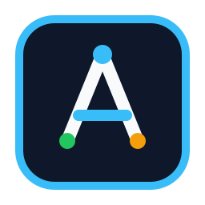

<p align="center">
  
</p>

<h1 align="center">AGY Harness</h1>

<p align="center">
  <a href="README.md">English</a> | <b>简体中文</b>
</p>

<p align="center">
  <a href="https://github.com/JsonLee12138/agy-harness/releases/tag/v0.4.0"></a>
  <a href="LICENSE"></a>
  <a href="https://github.com/JsonLee12138/agy-harness"></a>
  <a href="https://github.com/JsonLee12138/agy-harness"></a>
  <a href="https://github.com/JsonLee12138/agy-harness"></a>
</p>

**面向 Google Antigravity (`agy`)、Claude Code、Codex 及现代多智能体编程环境的自适应“生成-证伪”工程脚手架。**

底层搭载 25 个零侵入上游 [Addy Osmani Agent Skills](https://github.com/addyosmani/agent-skills)，配合净室版 `/agy-harness:harness-init`。

> [!IMPORTANT]
> **独立版本说明**：`agy-harness` 采用独立语义化版本体系（当前 **`v0.4.0`**），与上游 `agent-skills` `0.6.x` 解耦演进。

---

## 为什么选择 AGY Harness v0.4？

纯裸奔 Vibe Coding 容易产生不可维护的重复垃圾代码与后期大返工；而重型官僚框架动辄为小改动写四五份文档、反复重跑全量测试、在子代理里塞进数万字教科书，白白烧光 Token 和时间。`agy-harness` v0.4 在**高可用少返工**与**零无效消耗**之间取得最优平衡：

- **净室初始化 (`/agy-harness:harness-init`) + 全局 `hooks.json`**：仅向项目注入瘦身协调规则 `.agents/rules/agy-harness.md`（**`3,459 B`**，`<= 3.5 KB`）、多语言智能门禁 `scripts/gate-check.sh` 与精简 `.artifacts/{SPEC,CONSTRAINTS,PLAN}.md`。所有守卫逻辑通过插件根 [`hooks.json`](hooks.json)（`--plugin-mode`）在全局生效，**不再向业务仓库 `scripts/` 拷入 6,600 行脚本**，并自动清扫老版本 v0.1–v0.3 遗留的 `scripts/harness-*.sh`、`scripts/hooks/`、`.agents/hooks.json` 冗余项与空模板 `context-brief.md`（离线无全局插件团队可用 `--standalone` 收敛至 `.agents/hooks/`）。
- **三维自适应路由（`Trivial` / `Bug Fix` / `Contract`）**：
  - **Trivial（纯字面量/简单字段）**：改写死的值、常量、`.css/.scss` 样式、多语言 JSON、静态配置或无分支的 1:1 字段透传，主会话热缓存直接修改，免 `Stop` 全量重跑（`isTrivialExemptPath`）。
  - **Bug Fix（逻辑与异常 Bug）**：除纯字面量外的所有 Bug，必须**先只读排查根因 $\rightarrow$ 前置只读 `arch-redteam` 验方案防治标补丁 $\rightarrow$ 呈交【根因 + 红队校验后的建议方案】等你确认 $\rightarrow$ 精准修复 + 回归单测 + 门禁验绿**（主线中途穿插 Bug 可通过 `<!-- HARNESS_STATUS: PAUSED -->` 挂起主线）。
  - **Contract（业务封装/架构/高危路径）**：涉及公共封装（组件/Hooks/SDK/Middleware）、复杂状态流转、DB/API 变更、多方案分歧，或**哪怕只改 1 个文件但命中鉴权/输入拼接/加密/支付/并发等高危安全信号**，必须起草 `.artifacts/{SPEC,PLAN}.md` $\rightarrow$ **前置 `arch-redteam` 审校** $\rightarrow$ 1 次 `Proceed` 确认 $\rightarrow$ 允许主会话热缓存执行（并行分片用 `HARNESS_EXECUTION: SUBAGENT_ONLY` 切至 `slice-builder`）。
- **Git 内容指纹去重（`[Gate Dedup]`）与跨会话 `Stop` 隔离**：`scripts/gate-check.sh` 自动探测 `pnpm`/`bun`/`yarn`/`npm`、`cargo`、`go`、`ruff`/`pytest`、`dart`/`flutter`，全量通过后记录工作树 SHA-256 指纹（`--force` 强制重跑，`--fast` 增量快检），**同一份代码绝不重复跑第二遍**；`Stop` 钩子仅校验当前会话自身改动，彻底根除“A 会话脏树误伤 B 会话纯问答”的 Bug。
- **双层防卡死看门狗 & 子代理微胶囊化（`skills: []`）**：剥离 `agents/*.md` 中静态硬塞的 49KB/86KB 长篇教科书，改为高信噪比内置核查铁律（每次唤醒立省 ~12.5k–21.5k Token）；`slice-builder` 配备 `manage_task` + `PreToolUse` 自动注入 `NotificationTimeoutSeconds: 45` 应对 WS/DB 长连接挂起，主会话同步挂载 0 损耗自动取消的 `75s` `schedule(TimerCondition)` 巡检看门狗。

---

## 快速上手

### 1. 安装 `agy-harness`

```bash
agy plugin install https://github.com/JsonLee12138/agy-harness.git
agy plugin disable agent-skills   # 禁用重复的原版技能清单以省去首轮冗余 Token
```

### 2. 初始化或升级业务仓库

在目标项目内执行 `/agy-harness:harness-init` 或终端运行：

```bash
# 默认净室模式（推荐：复用全局插件钩子，并自动清理老版本 v0.1-v0.3 冗余脚本）：
bash ~/.gemini/config/plugins/agy-harness/scripts/init-harness.sh /path/to/your-project

# 离线独立模式（将钩子、核心库与本地代理收敛安装至 .agents/hooks/ 与 .agents/agents/）：
bash /path/to/agy-harness/scripts/init-harness.sh /path/to/your-project --standalone
```

---

## 三大精简核心子代理

| 子代理 | 工具权限与防卡死机制 | 职责 |
|---|---|---|
| [arch-redteam](agents/arch-redteam.md) | **严格只读**（`read_file` + 旧别名，`policy: off`，`skills: []`） | 呈交用户确认前审校 Bug 修复方案或 `.artifacts/{SPEC,PLAN}.md`，拦截治标补丁、安全漏洞与过度设计 |
| [slice-builder](agents/slice-builder.md) | 读写 + `run_command` + `manage_task`（`sandbox`，`skills: []`）+ [`slice-builder.hooks.json`](scripts/hooks/slice-builder.hooks.json) | 并发/重型切片 TDD 施工员；自动注入 `NotificationTimeoutSeconds: 45` 防 WS/DB 挂死，配合主控 `75s` 看门狗 |
| [staff-gatekeeper](agents/staff-gatekeeper.md) | **只读** + 短时 `run_command`（`sandbox`，`skills: []`）+ [`staff-gatekeeper.hooks.json`](scripts/hooks/staff-gatekeeper.hooks.json) | **4 合 1** 终审官：契约质量、奥卡姆修剪、反假测试变异核验及安全/性能边界审计 |

> 完整架构说明、Hooks 分层机制与验证指南请见 **[docs/antigravity-setup.md](docs/antigravity-setup.md)** 与 **[docs/agents.md](docs/agents.md)**。

---

## 验证命令

```bash
node scripts/validate-versions.js && \
node scripts/validate-skills.js && \
node scripts/validate-reference-links.js && \
node scripts/validate-artifact-paths.js && \
node scripts/validate-commands.js && \
CI=true node --test scripts/*test.js && \
node scripts/run-evals.js && \
agy plugin validate . && \
bash scripts/gate-check.sh --force && \
bash scripts/gate-check.sh
```

## 开源协议

MIT — 详见 [LICENSE](LICENSE)。
